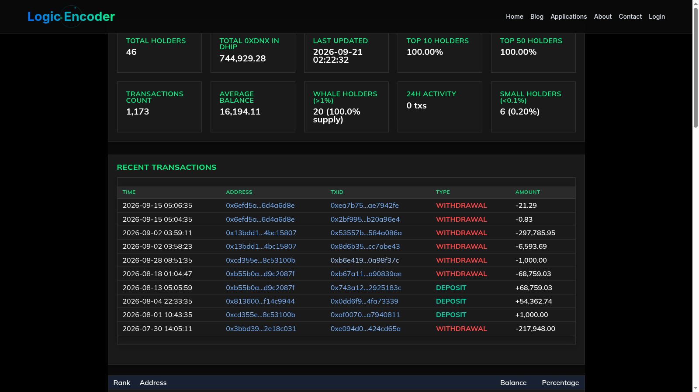

# 0xDNX DHIP Richlist — Holder Monitoring

A pool's holder distribution changes as participants deposit, withdraw and transfer their holdings. The 0xDNX DHIP Richlist monitor keeps that changing picture available for research: who holds a share, how the ranking has moved and which recent activity deserves attention.

It supplies the public [DHIP v2 richlist](https://logicencoder.com/0xdnx-dhip-v2-richlist/) and its connected WordPress dashboard. Readers can explore the distribution on the website, while the operator retains history and tools for reviewing the information behind it.

## Tech stack

| Layer | Technologies |
|---|---|
| Application | Python |
| Chain and analysis | Ethereum, Web3.py |
| History | SQLite |
| Publishing | WordPress, JSON |

## Follow the changing pool

The monitor follows Wrapped Dynex holdings in the DHIP v2 pool and distinguishes deposits, withdrawals and transfers between participants. That gives a movement its pool context instead of treating every transaction as the same kind of activity.

A useful review begins with a recent event, then checks the affected holder's balance and place in the distribution. The information supports investigation without assigning an unverified motive to the participant.

## Compare balances, ranks and shares

A ranked holder view brings balance, rank and percentage of pool holdings together. These answer different questions: the amount held, the position relative to other participants and the share of the tracked total.

The ranking can be reviewed as a whole or used to follow a specific address. Changes in one participant can then be understood alongside changes elsewhere in the pool.

## Return to earlier observations

Holder history includes balance, rank and share changes, with daily snapshots and concentration information for longer comparisons. This makes the product useful beyond a single current leaderboard.

Compare the distribution across selected observations, revisit a period of activity or inspect how the position of a tracked holder changed. Recent deposits and withdrawals provide another route into that history.

## Keep public pages informed

The operator can publish the tracked information to more than one configured WordPress site. Automatic updates support an ongoing richlist, while publication records help identify a site that needs attention.

The companion WordPress product provides the visitor-facing table, summaries and transaction browsing. Its purpose is to make the holder information accessible within the website; the monitor supplies the chain observations behind that experience.

## Catch up after an interruption

Historical catch-up and restart recovery support returning the monitor to current observations after downtime. Optional Etherscan-assisted historical reconciliation assists when the available chain history needs additional attention.

This matters when comparing an older snapshot with the current page: an operator can review progress and publication outcomes before treating the latest view as ready for use.

## Keep research and operation manageable

Exports, retained observations and readable activity records support offline review and follow-up investigations. The operator can use interactive configuration during preparation or run the monitor unattended as part of a longer monitoring routine.

The practical result is one maintained source for pool distribution and its history, with public browsing and operator review serving different parts of the same task.

---

Private code: [dynex-0xdnx-dhip-richlist-monitor](https://github.com/logicencoder/dynex-0xdnx-dhip-richlist-monitor)

[WordPress richlist dashboard](https://github.com/logicencoder/dynex-0xdnx-dhip-richlist-plugin-overview) · [Wrapped Dynex richlist guide](https://logicencoder.com/wrapped-dynex-richlist-0xdnx-dvhip-v2/)

See [REPOS.md](REPOS.md) for related repositories.

**[Logic Encoder](https://logicencoder.com)** · [GitHub](https://github.com/logicencoder) · [Contact](https://logicencoder.com/contact/)
